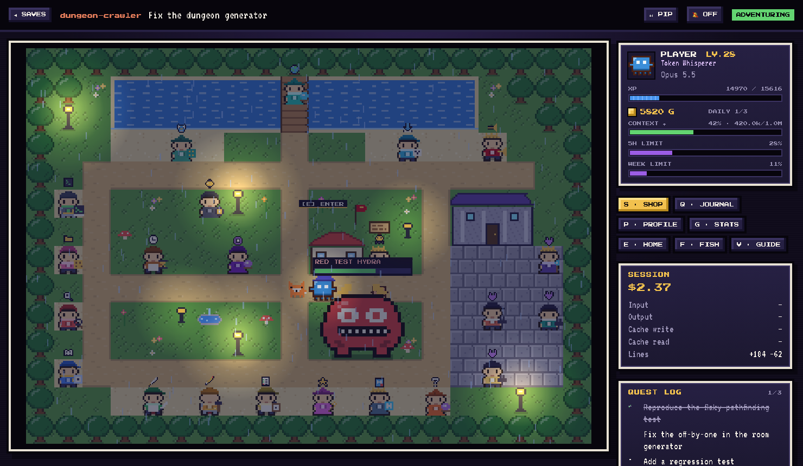
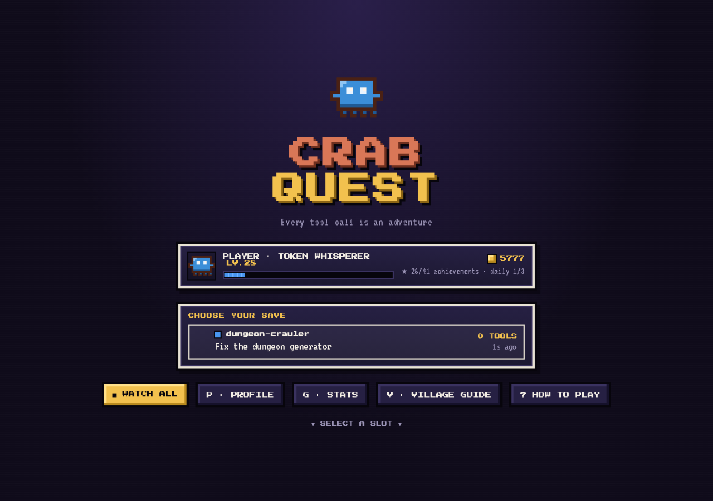
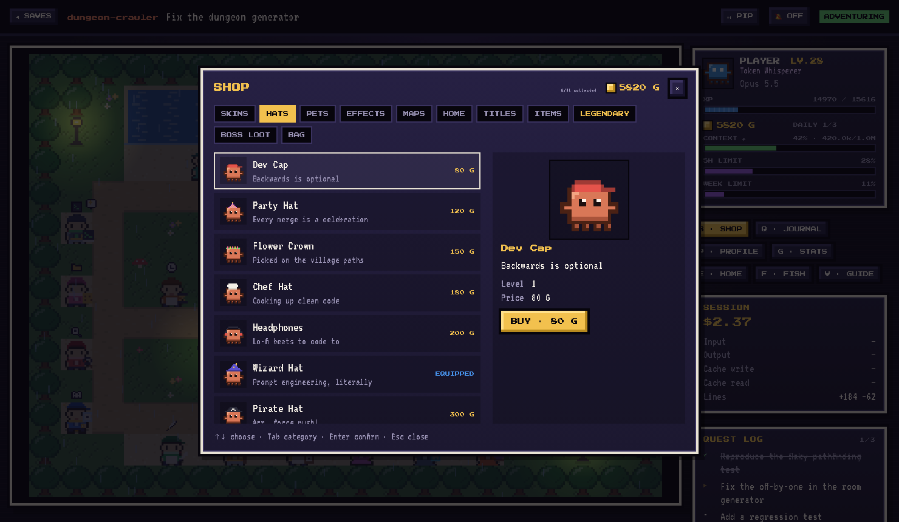
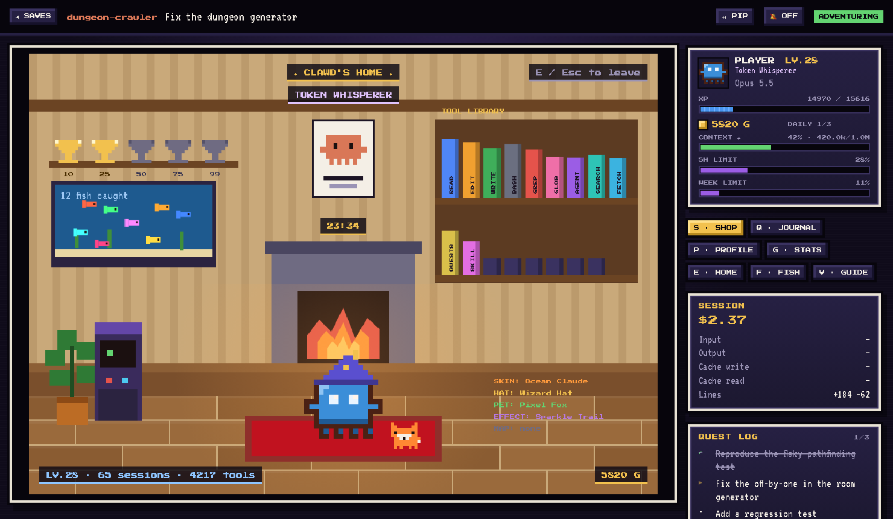
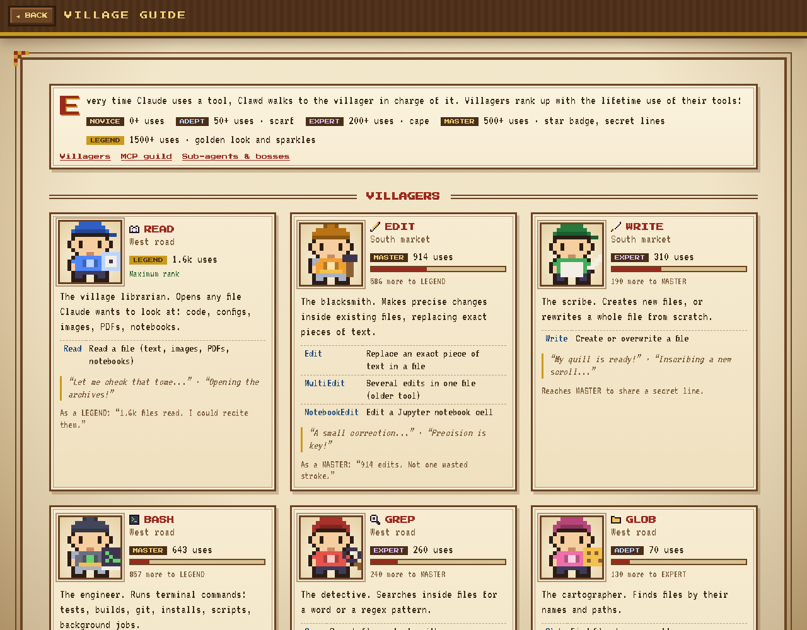
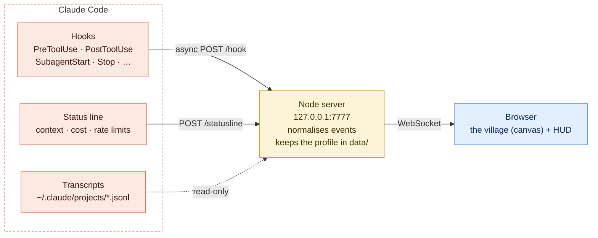

# Crab Quest

**A retro RPG that plays out your Claude Code sessions.** Every tool call sends
Clawd to a villager. Sub-agents run errands as little Clawds. Failures summon
bosses. Everything you do earns XP and gold to spend in the village shop.



- **Live**: driven by Claude Code hooks, no polling of your terminal.
- **Local**: a small Node server bound to `127.0.0.1`, with no account and no telemetry.
- **Zero build**: plain ES modules, procedural pixel art, a single `npm install`.

> Crab Quest is an unofficial fan project for Claude Code. It is not affiliated with, endorsed
> by, or sponsored by Anthropic. "Claude" and the Claude Code mascot are
> trademarks of Anthropic, PBC.

---

## Contents

- [Features](#features)
- [Quick start](#quick-start)
- [How it works](#how-it-works)
- [What `npm run setup` changes](#what-npm-run-setup-changes)
- [Playing](#playing)
- [Privacy and security](#privacy-and-security)
- [Configuration](#configuration)
- [Troubleshooting](#troubleshooting)
- [Development](#development)
- [License](#license)

## Features

**The village**
- 19 villagers, one per family of Claude Code tools: Read, Edit, Bash, Grep, the web, plan mode, worktrees, schedules, artifacts…
- An **MCP guild** where each of your MCP servers gets its own villager and keeps its seat.
- Villagers **rank up** with lifetime use (Novice → Legend) and change looks.
- An in-game **village guide** that explains what every villager, and every tool, does.
- Day and night follow your clock, with lamps at night. The weather follows the context window: rain, snow, then storm.

**Your session, visualised**
- Pre and post tool events are matched by `tool_use_id`: one trip per call, and failures show up on the spot.
- A thought bubble appears while Claude is thinking between tools.
- Sub-agents appear as little Clawds, and banners mark compaction, permission prompts and finished turns.
- The HUD shows real context usage, cost, 5-hour and weekly limits (from the status line), and the session quest log.
- A grid view shows every running session at once.
- **Picture-in-picture** keeps a live mini view on top of your other windows.

**Progression**
- A persistent local profile: levels 1–99, gold, 41 achievements.
- **Boss fights**: three failures in a row summon a boss matched to the error. Successful tool calls defeat it.
- **Daily quests**: three small challenges a day.
- A **shop** with 86 items: skins, hats, companions, trails, map themes, house furniture, titles, legendaries and boss loot.
- Clawd's **house** (trophies, aquarium, your furniture), and **fishing** on the bridge.
- Stats by day, week and month, by tool and by project.

**Optional**
- **Answer permission prompts from the game**, or from its picture-in-picture window. Off by default.
- **The server starts automatically** when a Claude Code session starts.

<table>
<tr>
<td></td>
<td></td>
</tr>
<tr>
<td></td>
<td></td>
</tr>
</table>

## Quick start

Requirements: [Claude Code](https://code.claude.com), Node.js 16 or later, `curl`, and a Chromium-based browser for the best experience (Chrome, Edge, Arc…).

```bash
git clone https://github.com/IDyapiI/Crab-Quest.git
cd Crab-Quest
npm install
npm run setup      # installs hooks + status line into ~/.claude/settings.json
npm start          # http://localhost:7777
```

Open <http://localhost:7777>, start a Claude Code session in any project, and
pick it on the title screen. From then on, the server also starts by itself
with each new Claude Code session.

To remove everything Crab Quest added to your settings:

```bash
npm run uninstall-hooks
```

## How it works



- **Hooks** are asynchronous `curl` calls: Claude Code never waits on the game. The only exception is the optional permission hook (see [Answering permission prompts](#answering-permission-prompts)).
- **The status line** shows your folder, branch, model, a context bar and the cost. It also forwards the same JSON to the server.
- **Transcripts** are read incrementally for token counts, the session title and the history. Usage is counted once per message: Claude Code repeats it on every content block.

## What `npm run setup` changes

Setup edits `~/.claude/settings.json` (or `$CLAUDE_CONFIG_DIR/settings.json`).
It first writes a timestamped backup next to it. It only adds or replaces
entries marked `# crab-quest`, so your other hooks are kept.

| Entry | Purpose | Blocking? |
| --- | --- | --- |
| 14 hook events → `curl … /hook` | Feed the game | No (`async`) |
| `SessionStart` → `scripts/ensure-server.js` | Start the server if it isn't running | No (`async`) |
| `PermissionRequest` → `scripts/permission-hook.js` | In-game permission answers | Only when enabled in-game **and** a game window is visible |
| `statusLine` → `scripts/statusline.js` | Status line + real context and cost | — |

Options: `--no-autostart`, `--no-permissions`, `--statusline-only`, `--uninstall`.

<details>
<summary>Using the Claude Code plugin instead of setup hooks</summary>

The event hooks are also packaged as a plugin in [`plugin/`](plugin). A plugin
can't provide a status line and doesn't know where this folder lives, so you
still need `npm run setup -- --statusline-only`:

```bash
claude plugin marketplace add /path/to/crab-quest
claude plugin install crab-quest@crab-quest
npm run setup -- --statusline-only
```

Don't use both the plugin and the full setup: events would arrive twice. The
server drops exact duplicates, but only send them once.
</details>

## Playing

### Keys

| Key | Action |
| --- | --- |
| `S` | Shop |
| `Q` | Journal: daily quests, session quests, villagers, achievements |
| `P` | Profile: stats, loadout, history, settings, transcript sync |
| `G` | Statistics |
| `V` | Village guide (or click a villager) |
| `E` | Enter / leave the house |
| `F` | Go fishing on the bridge, `Space` to reel in |
| `I` | Picture-in-picture |
| `C` | CRT filter |
| `D` | Debug panel (simulated events, handy to try things out) |
| `Esc` | Back |

### Progression

| Action | Reward |
| --- | --- |
| Tool call (counted once, on `PostToolUse`) | +5 XP |
| Sub-agent launched | +20 XP |
| Compaction survived | +100 XP |
| Every 5 levels | +50 gold |
| Achievement | Gold and XP |
| Boss defeated | 40–250 gold, XP, 30% chance of boss loot |
| Daily quest | 30–150 gold each, +100 for all three |
| Fishing | 2–25 gold per fish |

Level *L* needs `100 × L^1.5` total XP. XP potions (×2, ×3) and the gold elixir
(×1.5) last 5–10 minutes. Progress is saved in `data/profile.json` and
`data/sessions.json`, which are ignored by git.

### Bosses

Three failed tool calls in a row summon a boss matched to the error:

- **Red Test Hydra**: failing test commands.
- **Segfault Golem**: other failing shell commands.
- **Merge Conflict Wraith**: failed edits and writes.
- **404 Specter**: failed web searches and fetches.
- **Timeout Kraken**: failed MCP calls.
- **Bug Beast**: any other failure streak.

Every success hits the boss (Edit and Write hit twice) and every failure heals it.

### Picture-in-picture

Press `I` or click **⧉ PIP** in a session. In Chrome and Edge it opens an
always-on-top window with the live game and a status strip, and the game keeps
animating while the main tab is hidden. Other browsers get a video
picture-in-picture of the canvas.

### Answering permission prompts

Turn it on in **Profile → Settings**. When Claude asks for a permission and a
game window (or its picture-in-picture) is visible, an **ALLOW / DENY** prompt
appears in the game. If you don't answer within the chosen delay (45 s by
default), Claude Code shows its usual prompt in the terminal.

- `AskUserQuestion` and plan approvals always stay in the terminal.
- Claude Code doesn't show its own dialog while the hook is waiting. That's why the game only waits when you can actually see it.

## Privacy and security

- **Local only.** The server listens on `127.0.0.1`. It rejects requests whose `Host` or `Origin` isn't local, and cross-site WebSocket connections. Other websites open in your browser can't read your sessions or inject events.
- **What it reads**: hook payloads, the status line JSON and your transcripts under `~/.claude/projects`, all read-only.
- **What it writes**: `data/` in this folder and, through setup, your Claude Code `settings.json` (with a backup first).
- **Nothing leaves your machine.** The only external request is the browser loading two fonts from Google Fonts.
- **Permission decisions** need a per-launch token that only same-origin pages can read. Each decision applies to a single request.

## Configuration

| Variable | Default | Used by |
| --- | --- | --- |
| `PORT` | `7777` | Server, autostart |
| `CRAB_QUEST_URL` | `http://localhost:7777` | Hooks, status line, permission hook |
| `CRAB_QUEST_DATA` | `./data` | Where the profile is stored |
| `CLAUDE_CONFIG_DIR` | `~/.claude` | Settings file and transcripts location |

## Troubleshooting

- **Nothing moves.**
  - Is the server up? Check `curl http://localhost:7777/api/sessions`.
  - Were the hooks installed? Run `npm run setup` again.
  - Claude Code picks up new hooks in new sessions.
- **The title screen is empty.** A session only appears after its first hook event: send a prompt.
- **"Port 7777 is already in use".** Another Crab Quest server is already running. That's fine: the autostart hook does this check too.
- **The server doesn't start by itself.** Look at `data/server.log`. Autostart runs the Node binary that executed `npm run setup`: re-run setup if you switched Node versions.
- **Picture-in-picture opens on the second click only.** Some embedded browsers expose the Document PiP API but can't open windows. The game then falls back to video PiP, which needs a fresh click.

## Development

No build step: edit a file and reload the page. `npm start` runs the server.
For experiments, point it at a throwaway profile so your progress stays intact:

```bash
CRAB_QUEST_DATA=/tmp/cq-demo PORT=7790 node server/index.js
```

Then press `D` in a session to fire simulated events.

```
server/            Express + WebSocket
  index.js         routes, fan-out, origin checks
  events.js        hook payload → compact game event
  store.js         live sessions (bounded history, thinking status)
  transcript.js    incremental JSONL reader
  profile.js       the local player: XP, gold, items, dailies (data/*.json)
  progress.js      events → progression, boss fights
  catalog.js       achievements, shop items, fish, daily quests
  boss.js          boss state machine
  permissions.js   in-game permission prompts
  api.js           /api/* (profile, shop, stats, history, sync)
  pricing.js       model prices and context windows
public/js/         ES modules, no build
  app.js           screens, WebSocket, HUD
  game.js          engine: jobs, villagers, sub-agents, rendering
  world.js         map, pathfinding, pre-rendered background
  sprites.js       procedural pixel art
  tools.js         tool → villager mapping, villager data
  cosmetics.js     skins, hats, pets, trails, map themes
  shop.js, panels.js, guide.js, house.js, decor.js, bossfight.js, fx.js, pip.js
plugin/            Claude Code plugin (event hooks)
scripts/           setup, status line, autostart, permission hook
docs/              README screenshots
```

Transcripts use an internal Claude Code format that can change between
versions. `server/transcript.js` reads every field defensively. If token
counts look wrong after a Claude Code update, start looking there.

Contributions are welcome: open an issue to discuss bigger changes first.

## License

[MIT](LICENSE). Pixel art is procedural and ships with the code.
